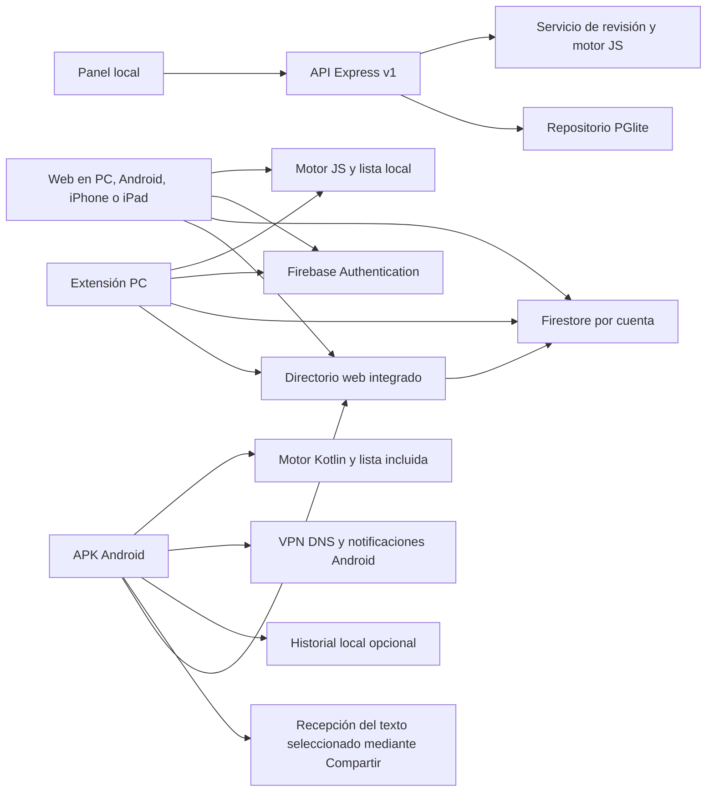

# Arquitectura de Aquila Guard

Referencia para la defensa. Web 0.6.14, extensión 0.6.14 para instalación manual, Android 0.3.25 beta, revisor Windows 0.6.13 y API académica v1. La ficha pública mostraba la extensión 0.6.12 el 21 de noviembre de 2026.

## Acceso principal: web portable

El panel visual del servidor se adapta a la web pública: Inicio, Revisar, Mi historial, Resumen y Mi cuenta. El usuario abre el enlace; no necesita Node, un servidor local, una extensión ni un instalador. Los resúmenes que guarda voluntariamente se recuperan con la misma cuenta verificada desde otro equipo. El texto original de correos y mensajes permanece en memoria. Los contadores se calculan sobre los últimos 50 registros recuperados y no representan protección ni estafas evitadas.

La revisión funciona si el navegador bloquea service workers o almacenamiento: los primeros son opcionales y la sesión puede mantenerse solo en memoria, avisando que se pierde al recargar. La carga inicial, la cuenta y el historial requieren los accesos de red correspondientes. No se evaden HP Wolf ni las políticas de TI. La web no observa otras pestañas ni notificaciones de otras aplicaciones.

## Recorridos para demostrar

- **Hito 2.** El panel de escritorio local consume la API Express. Crear un análisis ficticio, consultar su ID, editar una nota, recuperarla y borrar el análisis. Al repetir la creación con la misma clave, se recupera el mismo ID.
- **Hito 3.** Usar la interfaz de la API académica para ingresar un caso ficticio, guardar el resultado, marcarlo como revisado y recuperarlo después de recargar. Es el recorrido principal para evaluar la integración. El portal público ofrece un recorrido independiente con historial en Firestore mediante cuenta verificada.
- **Complemento Android.** La APK analiza localmente y puede avisar cuando un dominio es visible por DNS. Su historial es local y opcional. La app web en Android sí participa en el flujo de historial de Firebase. La APK requiere validación física de navegación, notificaciones y recuperación tras detener la VPN.
- **Mensajes y teléfonos.** La extensión analiza el mensaje visible en Gmail o Mensajes web bajo autorización por pestaña. Android recibe texto que el usuario comparte y abre el directorio web integrado. El directorio comparte fichas de consulta por huella, separadas del historial. El envío de reportes es privado y queda pendiente de revisión. Véase [Reportes de teléfonos](docs/Reportes_Telefonos.md).

## Capas y datos

En Express, la ruta y el controlador reciben HTTP, validan el contrato y traducen errores a estados. El servicio aplica el motor y la política de reintentos. El repositorio usa SQL parametrizado. PGlite conserva resúmenes, motivos y notas. El texto original se procesa en memoria y la migración 003 elimina la columna histórica que lo guardaba. Los reintentos conservan una clave, una huella HMAC y el ID asignado, incluso si el análisis se elimina.

En la web y la extensión, el análisis ocurre en el dispositivo. Guardar un resumen es voluntario. Firestore aplica reglas por UID y exige correo verificado. El directorio requiere además un permiso de consulta acotado. En Android, Compose presenta los estados y el analizador Kotlin trabaja sobre la copia local. La VPN informa sobre los dominios que observa. Las versiones de desarrollo 0.3.22 y 0.3.23 experimentaron con vistas previas. Esa capacidad se retiró de la beta distribuida.

## Decisiones y costos

| Decisión | Alternativa y costo |
|---|---|
| Express + TypeScript | Mantiene la API en el mismo entorno que el motor JavaScript y permite validar el contrato en tiempo de ejecución. FastAPI aporta un ecosistema distinto y habría exigido portar el motor o comunicar dos procesos. |
| PGlite para el Hito 2 | Una base SQL persistente sin administrar un servidor para la demo. PostgreSQL servidor permitiría separar operación y datos, con más configuración, credenciales y despliegue. El adaptador pg requiere prueba externa. |
| Monolito académico | Un proceso para un equipo de tres y una demo pequeña. Como supuesto de dimensionamiento se consideran tres integrantes y un evaluador haciendo un ensayo interactivo, sin una carga masiva esperada. La cuota de la API es 60 solicitudes autenticadas por minuto y ocho simultáneas. Es un límite configurado, no una medición de capacidad. |
| Firebase para el producto web | Evita operar un servidor público y permite compartir historial. Sus cuotas y disponibilidad afectan el inicio de sesión y la sincronización. Un servidor propio daría más control de tráfico, con costo operativo y cambios de arquitectura. |
| Android nativo | Kotlin y Compose permiten usar VpnService y las notificaciones de Android. El análisis por DNS ve dominios, y los dos motores requieren pruebas para detectar divergencias. |

## Red, caché y recuperación

La web carga HTML, JavaScript y la lista por HTTPS. La PWA puede usar la lista y recursos ya guardados en caché. La APK trae su copia y puede revisar enlaces sin conexión. El historial web necesita conexión, y los intentos de guardar pueden repetirse cuando vuelve el servicio. No hay una cola de sincronización offline. El DNS seguro, la caché y los cambios de red afectan la observación en Android.

## Trazabilidad y referencias

Unidad 1 de INGT1003, secciones de cliente-servidor, capas y arquitectura de información móvil. Unidad 2, secciones de REST, idempotencia, separación por capas, monolito e integración web y móvil. Ver también la rúbrica del Hito 2 y del Hito 3. La revisión técnica del motor, sus cuotas y sus credenciales se apoya en [REST de Firestore](https://firebase.google.com/docs/firestore/use-rest-api), [reglas de autenticación](https://firebase.google.com/docs/rules/rules-and-auth), [cuotas de Firestore](https://firebase.google.com/docs/firestore/quotas), [servicio VPN de Android](https://developer.android.com/develop/connectivity/vpn) y [Express](https://expressjs.com/).

## Demostración desde la web publicada

En Mi historial, el apartado «Ver los detalles de la prueba de guardado» registra operación y estado HTTP de las respuestas de Firestore. El recorrido usa el mismo historial que la extensión. La API REST de Firestore recibe consultas mediante POST runQuery y escrituras mediante POST commit. Su demostración cubre crear, consultar, actualizar y borrar el resumen. El motor de análisis se ejecuta en el cliente. La API Express propia mantiene sus recursos y su demostración independiente para la exigencia académica.
